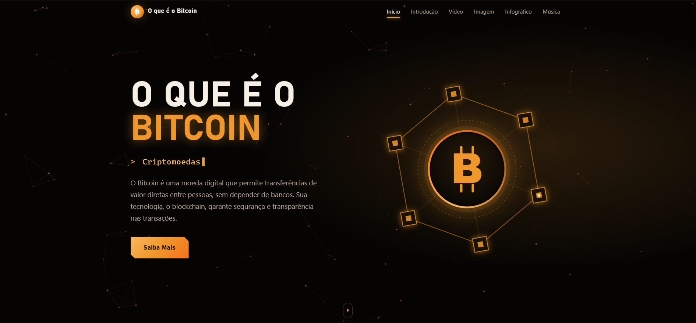
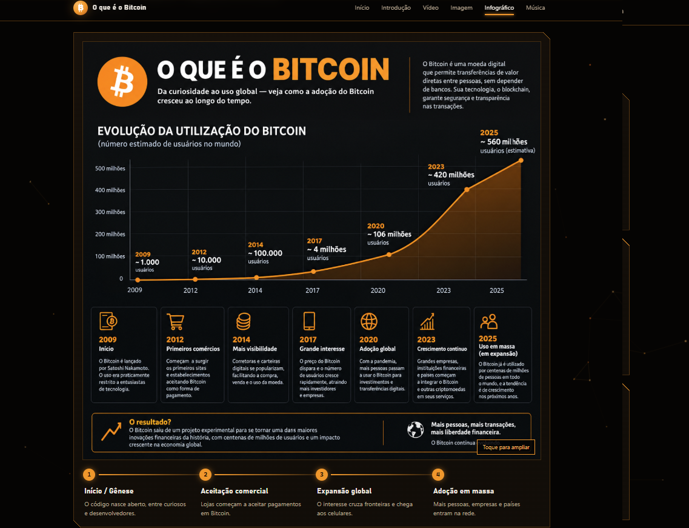
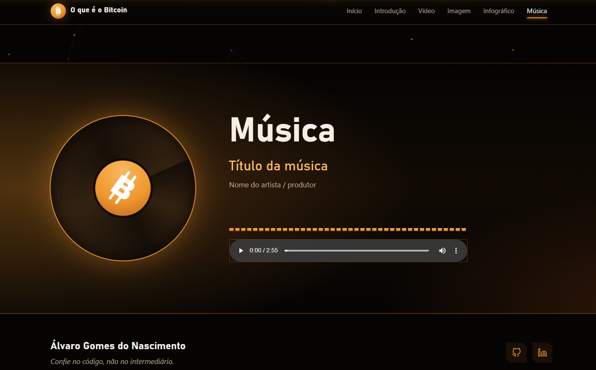

# ₿ Projeto IA — O que é o Bitcoin?

Projeto desenvolvido durante o **Curso de Formação em Inteligência Artificial do Instituto PerCor re**, com o objetivo de apresentar informações sobre o Bitcoin, a tecnologia blockchain e a evolução das criptomoedas de forma visual, interativa e acessível.

O site combina desenvolvimento front-end, animações e recursos multimídia em uma interface com identidade visual inspirada no universo das criptomoedas e no estilo cyberpunk.

---

## 📸 Demonstração do projeto

### 🖥️ Página inicial



### 📚 Introdução ao Bitcoin



### 📊 Infográfico sobre o Bitcoin


### 🎵 Seção de música



> **Observação:** para exibir as imagens, crie a pasta `imagens/prints/` e adicione as capturas de tela com os nomes utilizados acima.

---

## 🎯 Objetivo do projeto

Desenvolver uma página web informativa sobre o Bitcoin, apresentando conceitos como criptomoedas, blockchain, segurança digital e descentralização.

O projeto também busca aplicar conhecimentos de programação e design na criação de uma interface moderna, responsiva e interativa.

---

## 🚀 Tecnologias utilizadas

### HTML5
Utilizado para estruturar o conteúdo da página, criar as seções de navegação e incorporar imagens, vídeos, áudios e links.

### CSS3
Responsável pela identidade visual e pela estilização da interface.

Principais recursos utilizados:
- Layout responsivo com Media Queries.
- Variáveis CSS para cores, fontes e medidas.
- Animações e transições.
- Gradientes, sombras e efeitos de iluminação.
- Efeitos visuais inspirados no estilo cyberpunk.
- Adaptação para dispositivos móveis.

### JavaScript
Utilizado para implementar funcionalidades interativas e animações.

Principais recursos:
- Menu responsivo para dispositivos móveis.
- Barra de progresso da rolagem.
- Destaque automático da seção ativa.
- Animações de entrada durante a rolagem.
- Fundo animado com partículas conectadas.
- Efeito de inclinação 3D na seção inicial.
- Controle de reprodução de áudio e vídeo.
- Visualizador de imagens com zoom (*lightbox*).
- Equalizador visual animado.
- Atualização automática do ano no rodapé.

### Canvas API
Utilizada para desenhar o fundo animado com partículas e conexões entre nós.

### SVG
Utilizado na criação de ícones vetoriais e ilustrações, incluindo o símbolo do Bitcoin e a representação de uma rede blockchain.

### HTML5 Multimedia
Utilizado para incorporar vídeos e músicas por meio das tags `<video>` e `<audio>`.

---

## 🤖 Inteligência Artificial

Este projeto foi desenvolvido no contexto do **Curso de Formação em Inteligência Artificial do Instituto PerCor re**.

A proposta foi explorar conceitos relacionados ao Bitcoin e aplicar conhecimentos tecnológicos na construção de uma experiência web interativa.

**Ferramentas de IA utilizadas:** [adicione aqui as ferramentas que você realmente utilizou].

**Aplicação da IA:** [descreva como a inteligência artificial contribuiu para a pesquisa, o planejamento ou o desenvolvimento do projeto].

---

## ✨ Funcionalidades

- Interface moderna com tema cyberpunk.
- Paleta de cores inspirada no Bitcoin.
- Navegação por seções com rolagem suave.
- Menu adaptado para dispositivos móveis.
- Fundo animado com partículas interconectadas.
- Ilustração animada de uma rede blockchain.
- Efeitos visuais ao passar o mouse.
- Animações de entrada durante a rolagem.
- Conteúdo educativo sobre o Bitcoin.
- Área para vídeo e imagem de destaque.
- Infográfico com etapas da adoção do Bitcoin.
- Visualizador de imagens com zoom.
- Player de áudio com animação visual.
- Links para GitHub e LinkedIn.
- Recursos de acessibilidade e suporte à preferência por movimento reduzido.

---

## 📂 Estrutura do projeto

```text
projeto-bitcoin/
├── index.html
├── README.md
├── css/
│   └── style.css
├── js/
│   └── script.js
├── imagens/
│   ├── perfil.jpg
│   ├── perfil-placeholder.svg
│   ├── imagem.jpg
│   ├── infografico.png
│   └── prints/
│       ├── home.png
│       ├── introducao.png
│       ├── infografico.png
│       └── musica.png
├── video/
│   └── video.mp4
└── musica/
    └── musica.mp3
```

> A estrutura é uma referência baseada nos caminhos utilizados no HTML. Ajuste os nomes de acordo com os arquivos existentes no seu repositório.

---

## ▶️ Como executar o projeto

1. Clone ou baixe este repositório.
2. Mantenha os arquivos nas pastas indicadas no HTML.
3. Abra o arquivo `index.html` em um navegador.
4. Explore as seções, as animações e os recursos multimídia.

O projeto utiliza HTML, CSS e JavaScript nativo, sem necessidade de instalar frameworks ou bibliotecas externas.

---

## 📱 Responsividade e acessibilidade

O site foi desenvolvido para se adaptar a diferentes tamanhos de tela, incluindo computadores, tablets e celulares.

Também utiliza recursos de acessibilidade, como:

- Textos alternativos para imagens.
- Identificação de elementos interativos com atributos ARIA.
- Navegação por teclado.
- Link para pular diretamente ao conteúdo principal.
- Suporte à preferência por movimento reduzido.

---

## 🎓 Informações acadêmicas

- **Curso:** Formação em Inteligência Artificial
- **Instituição:** Instituto PerCor re
- **Projeto:** O que é o Bitcoin
- **Desenvolvedor:** Álvaro Gomes do Nascimento

---

## 👨‍💻 Desenvolvedor

**Álvaro Gomes do Nascimento**

- GitHub: [@alvarogomes2305](https://github.com/alvarogomes2305)
- LinkedIn: [Meu perfil profissional](https://www.linkedin.com/in/alvaro-gomes-500139331/)

---

## 📄 Licença

Projeto desenvolvido para fins educacionais.

Caso queira permitir a reutilização e distribuição do código, considere adicionar uma licença ao repositório.

---

⭐ Obrigado por visitar meu projeto!
